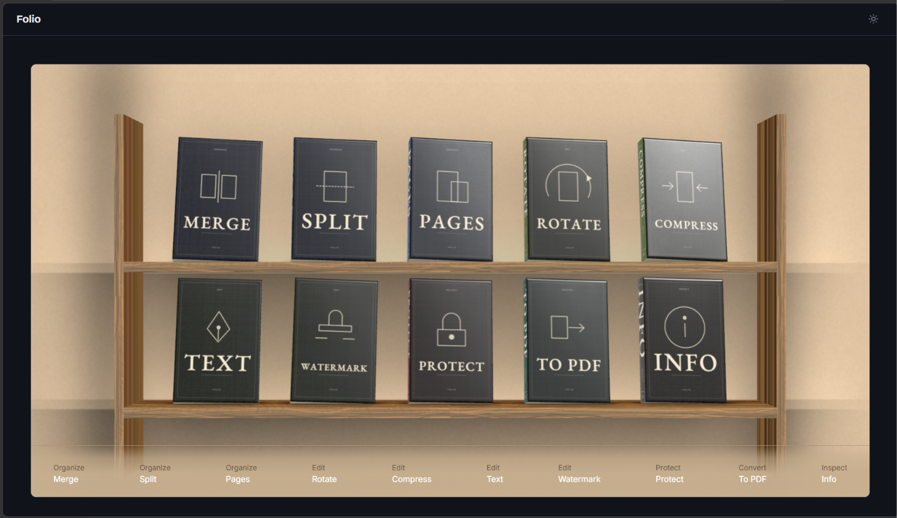
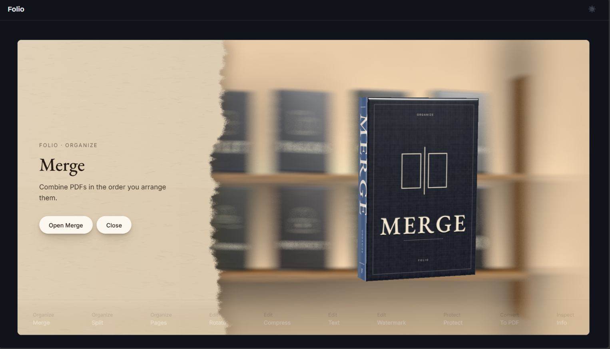

<div align="center">

# Folio

**A private PDF toolkit that lives on a 3D bookshelf.**

Pick a book, open a tool. Merge, split, edit, watermark, lock and convert PDFs without a single file leaving your computer.




</div>

---

## What is Folio?

Most online PDF tools make you upload your files to a stranger's server. Folio does the opposite. It's a small web app that runs **on your own machine**, opens in your browser, and is only reachable from `127.0.0.1`. No accounts, no uploads, no tracking, no CDN requests.

The home screen is a 3D shelf of ten books. Each book is a tool. Hover to lift a spine, click to take a book down, then open its tool. Inside a tool, the interface is deliberately calm: a drop zone, a strip of real page thumbnails, and one clear button.

<div align="center">

</div>

## The ten books

| Book | What it does |
| --- | --- |
| **Merge** | Combine PDFs in the order you drag them into |
| **Split** | Cut a PDF at lines you click, or into one file per page |
| **Pages** | **Extract** chosen pages into a new PDF, or **Delete** pages |
| **Rotate** | Turn chosen pages by 90°, 180° or 270° |
| **Compress** | Shrink a file, lossless or Strong (trades some image quality for size) |
| **Text** | **Read** all the text out of a PDF, or **Edit** it: change words, font, size and colour, delete lines, add new text |
| **Watermark** | Stamp text or an image: opacity, angle, tiled or corner, on chosen pages, behind or over the content |
| **Protect** | **Lock** a PDF with an AES-256 password, or **Unlock** a copy |
| **To PDF** | Convert Word, Excel, PowerPoint, images, text, HTML and more into PDFs |
| **Info** | Pages, size, PDF version, title and metadata |

## Highlights

- **Private by design.** The server binds to `127.0.0.1` only. Temporary files are deleted right after each response, and anything older than an hour is swept at startup.
- **See your pages.** Real thumbnails drawn by a bundled pdf.js. Delete, extract, rotate and reorder act on the sheets you can see.
- **Real text removal.** When you delete text in the editor it is removed from the file, not just covered. Reading the saved file back shows it is gone.
- **Exact Word output.** Conversion drives the Microsoft Office you already have, so a `.docx` becomes the same PDF Word's own *Save as PDF* would make.
- **Works without WebGL.** If the 3D scene can't run, or reduced motion is on, the home becomes a plain list of the same ten tools. Full keyboard use throughout.
- **Light and dark themes**, remembered between visits.

## Quick start

You need Windows and Python 3.11 or newer.

```powershell
git clone https://github.com/robinxheart/folio.git
cd folio
pip install -r requirements.txt
python server.py
```

Then open **http://localhost:5000**. The server opens it for you. Stop it with `Ctrl+C`. Set `FOLIO_NO_BROWSER=1` if you don't want the browser to open automatically.

**For Convert to PDF** you need a desktop copy of Microsoft Office (Word, Excel or PowerPoint, depending on the file type). Images convert without it, and every other tool works without Office.

## How it works

```
Browser (HTML, CSS, vanilla JS)  <--HTTP-->  Flask on 127.0.0.1:5000
  3D shelf (Three.js)                          pypdf, PyMuPDF, Pillow
  page strip (pdf.js)                          Office via COM, in a worker
                                               process with a timeout
```

- The interface is plain HTML, CSS and JavaScript: no framework, no build step.
- PDF operations use `pypdf` and `PyMuPDF`.
- Office conversions run in a separate worker process, one at a time, with a 120 second timeout, so a stuck Office window can't freeze the server.
- Everything the page needs (Three.js, pdf.js, fonts, icons) is bundled in `static/`.

## Limits worth knowing

- **Text editing works on lines, not paragraphs.** A much longer replacement shrinks to fit instead of reflowing. It's great for fixing a name, date or number.
- **Scanned PDFs can't be edited or read** because there is no real text in them. Folio says so instead of guessing (no OCR yet).
- **Fonts that aren't embedded or standard** are swapped for the closest bundled font, with a note.
- **Corner watermarks at steep angles** can clip past the page edge. Centre or tiled is the safe choice.
- Uploads are capped at **100 MB** per file.

## Troubleshooting Office conversion

Convert to PDF drives the Word, Excel and PowerPoint installed on your machine through Windows COM, in a separate worker process, one conversion at a time, with a 120 second timeout.

- **"Office not found".** Folio checks the registry at startup. Make sure a desktop Office (Microsoft 365 or a perpetual licence) is installed and has been opened at least once. Store-only Office and Office on the web don't expose the COM interface Folio needs.
- **A conversion hangs or fails.** Close any Office dialog left open (a licence prompt, a "file in use" notice) and try again. The worker kills its own Office instance on timeout, and your open documents are never touched.
- **A file converts with odd layout or missing fonts.** Open it in the source app and export it manually. Folio uses the same engine, so a document Office can't lay out won't convert better here.
- **`.odt`, `.ods`, `.odp` files.** These go through Office's OpenDocument support. If one fails, open and re-save it in Office once.
- **Several files at once.** Conversions run one at a time on purpose, because Office COM isn't safe in parallel. A second file waits its turn.

## Project layout

```
server.py          Flask app and API endpoints (127.0.0.1 only)
pdf_ops.py         PDF operations (pypdf)
pymupdf_ops.py     Watermark and text editing (PyMuPDF)
convert_ops.py     Office conversion orchestration
convert_worker.py  Per-conversion worker process
static/            The interface: app.js, style.css, shelf/, vendor/, fonts/
DESIGN.md          The design system the interface follows
PDFTOOL_SPEC.md    The original build specification
```

## Built with

Python, Flask, pypdf, PyMuPDF, Pillow, pywin32, cryptography, Three.js, pdf.js, and a lot of patient prompting in [opencode](https://opencode.ai).

## Licenses of bundled software

| Component | License |
| --- | --- |
| Three.js | MIT |
| pdf.js | Apache-2.0 |
| PyMuPDF | AGPL-3.0 |
| Flask, pypdf | BSD-3-Clause |
| DejaVu fonts | Permissive (see `static/fonts/LICENSE_DEJAVU`) |
| Inter, EB Garamond, Instrument Sans, Bricolage Grotesque | SIL Open Font License 1.1 |

The shelf scene is adapted from ThreeUI's *AshenPress* component. The source and its SHA-256 are recorded in the header of `static/shelf/shelf.js`.

PyMuPDF is AGPL-3.0, so if you distribute or host Folio publicly you must comply with that license (or obtain a commercial one from Artifex). Running it privately on your own computer has no such requirement.

## Author

Made by [@robinxheart](https://github.com/robinxheart), a cybersecurity student who got tired of uploading assignments to random websites. Keeping files private is the whole point.
